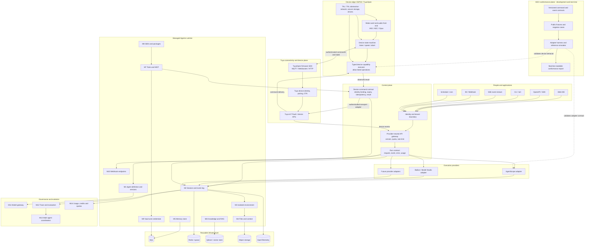

# Managed Agents Architecture

## Design intent

The target is a provider-neutral managed agent platform with an IoT execution edge. A business client or device event invokes a versioned cloud agent through a stable contract. The cloud owns identity, reasoning, planning, knowledge, policy, evaluation, and usage evidence. Tuya Cloud is the device/product connectivity plane; ESP32 is a resource-constrained deterministic executor for wake-word/audio capture, local state, playback, and explicitly authorized device actions. AgentScope is one cloud execution provider, not the platform boundary.

**Project scope:** this is the destination architecture for AgentPanel. The repository grows into it in verified slices; the current slice is the AECI contract, public fixtures, and reference runner. AgentScope is the first imported cloud runtime candidate, while its runtime adapter, the managed-agent control plane, Tuya services, and ESP32 firmware are not yet integrated. The conformance harness validates adapter behavior at development/test time; it is not a production authorization service.

## Re-drawn architecture

## Boundary rules

1. **Access is transport, not business logic.** Every entry point maps to the same request and event contract.
2. **The control plane is provider-neutral.** AgentScope and Bailian are adapters behind the contract, so switching providers does not rewrite clients.
3. **Runtime resources are versioned and scoped.** Agent, session, files, memory, skills, credentials, and tools carry tenant and authorization context.
4. **Governance consumes evidence.** Evaluation, rollout, fleet coordination, and usage must read the same event and trace records as operators.
5. **Upstream remains upstream.** `vendor/agentscope/` is an immutable v2.0.10 source snapshot; project integrations live under `adapters/` and never modify vendor files.
6. **Cloud decides; edge executes bounded actions.** Planning, LLM calls, long-term memory and RAG stay in the cloud. The ESP32 handles latency-sensitive audio/device state and only exposes typed, allow-listed actions.
7. **MCP is a cloud capability interface, not a trust boundary.** The cloud MCP client invokes an authorized device capability through an adapter. Device firmware need not implement MCP itself. Every call is authorized, schema-validated, bounded by rate/timeout, and recorded with a result. Physical state must be read back where supported.
8. **Transport is replaceable.** MQTT, WebSocket and HTTP are protocol adapters. They map to the same device command/event envelope with identity, sequence, expiry and idempotency semantics. A transport without authenticated integrity cannot carry privileged actions.
9. **OTA and credentials are separate control paths.** Firmware rollout is signed, staged and rollback-capable. Device secrets remain in secure storage and never enter prompts, traces or MCP arguments.

## Delivery slices

| Slice | User outcome | Evidence |
| --- | --- | --- |
| S0 | Run one deterministic lifecycle without a model key | stable JSONL trace and exit code |
| S1 | Run the same contract through an AgentScope adapter | adapter conformance report |
| S2 | Create, resume, stream, and archive isolated sessions | replayable event log |
| S3 | Authorize tools, credentials, files, memory, and RAG | deny/allow fixtures with audit records |
| S4 | Route between AgentScope and Bailian | identical client contract, provider comparison |
| S5 | Evaluate, roll out, coordinate, and meter | trace-linked score, version decision, usage record |
| S6 | Connect a Tuya/ESP32 device as a constrained executor | paired identity, signed command envelope, device MCP conformance trace, physical-state verification |

The AECI conformance plane is a test-time cross-cutting capability, not another production service in the request path. Its present scope is the device-command contract and simulator vectors; the AgentScope adapter and hardware adapter tests remain future work.

## External design references

- [TuyaOpen](https://github.com/tuya/tuyaopen) is the firmware and AI-IoT integration baseline. Reuse its supported targets, device security, connectivity and OTA path; do not fork its HAL/TAL/TKL stack into this repository.
- [TuyaOpen ESP32 platform](https://github.com/tuya/TuyaOpen-esp32) is a platform component of the parent TuyaOpen project, not a standalone SDK. Pin it through the supported TuyaOpen release when a firmware adapter is built.
- [xiaozhi-esp32-server-java](https://github.com/joey-zhou/xiaozhi-esp32-server-java) is a useful deployment reference for separating device/admin lifecycle from realtime dialogue processing. Its repository documents separate management/OTA and dialogue processes; reuse the separation principle, not its product-specific APIs as our contract.
- [AgentScope](https://github.com/agentscope-ai/agentscope) is the first candidate cloud runtime. The exact v2.0.10 source snapshot is stored in `vendor/agentscope/`; it is not yet wired into the runtime or control plane.

These references demonstrate available components and patterns. They do not prove this repository has a downstream adopter, Tuya commercial entitlement, or hardware validation. Those require an actual supported board, account/API access and external usage evidence.
